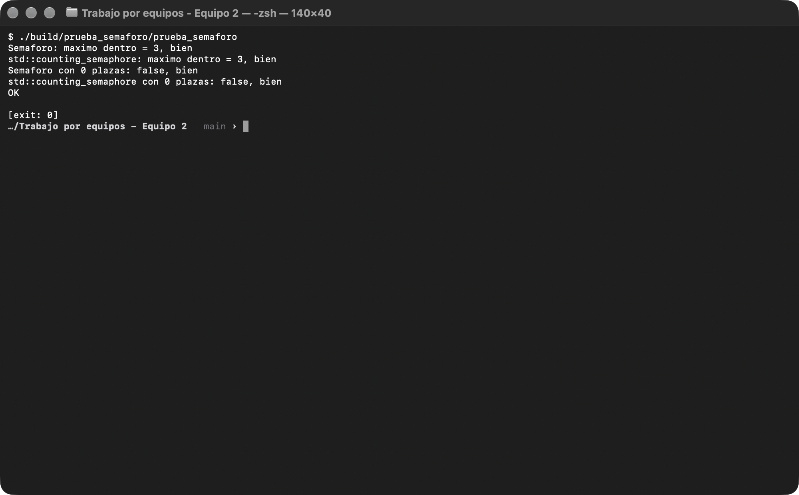
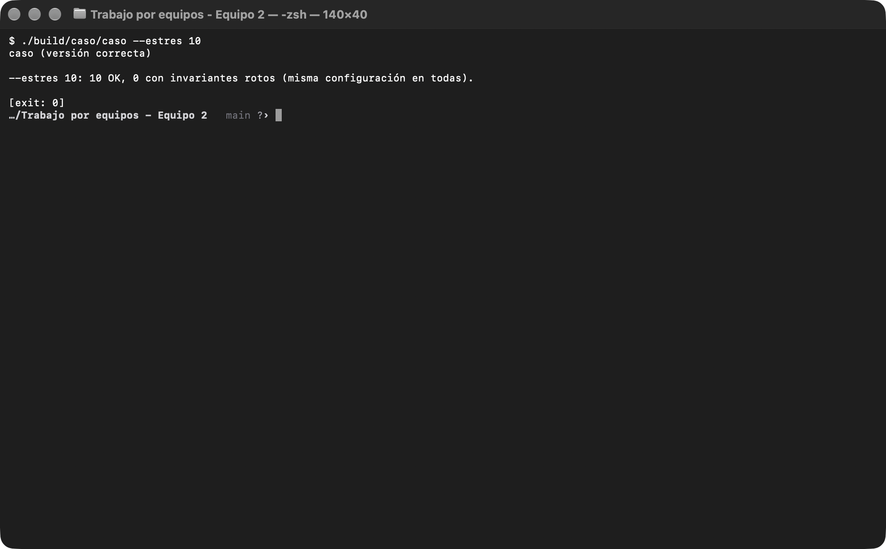
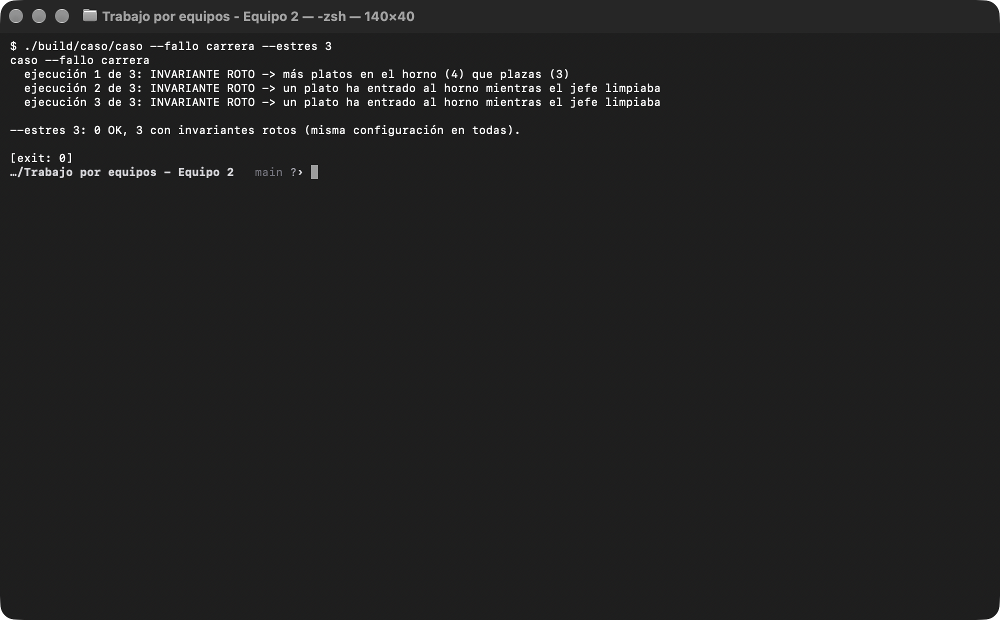
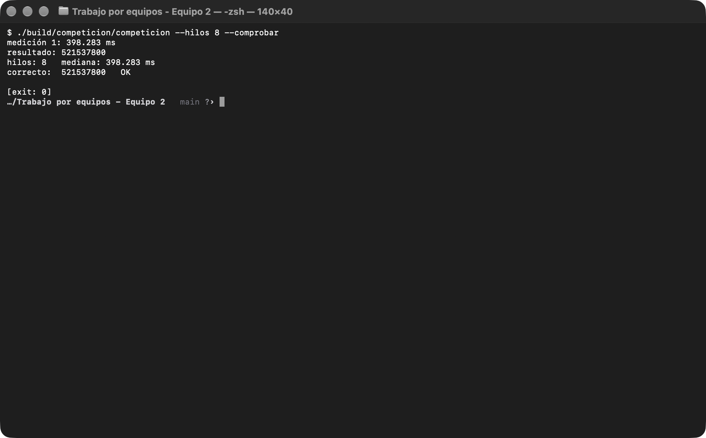

# Trabajo por Equipos — Equipo 2

**Asignatura:** Programación Concurrente y Distribuida (Temas 3 a 8).  
**Equipo 2:** Marcos de Aza, Ming Xu, Mireia Martínez, Ignacio Catalá y Joan Balbastre.  
**Caso asignado:** Caso 2 — Cocina de un restaurante.

---

## 1. Requisitos y Compilación

El proyecto está desarrollado en **C++20** y se compila sin dependencias externas mediante **CMake**:

```bash
# Configuración y compilación
cmake -S . -B build
cmake --build build
```

Compatible y verificado con `clang++` y `g++` con advertencias estrictas (`-Wall -Wextra -Wpedantic`).

---

## 2. Modos de Ejecución

### A. Prueba Unitaria del Semáforo
Comprueba que el `Semaforo` implementado como monitor admite un máximo de 3 hilos concurrentes y responde correctamente a plazos de tiempo:
```bash
./build/prueba_semaforo/prueba_semaforo
```

---

### B. Simulación del Caso (Cocina de un Restaurante)

```bash
# 1. Ejecución normal correcta (todos los invariantes deben dar OK):
./build/caso/caso

# 2. Prueba de estrés (repite 20 veces la simulación para verificar ausencia de carreras):
./build/caso/caso --estres 20

# 3. Modo Fallo: Condición de Carrera (rompe la exclusión mutua al entrar al horno):
./build/caso/caso --fallo carrera --estres 5

# 4. Modo Fallo: Interbloqueo (espera circular de utensilios; vigilante termina con código 3 a los 2s):
./build/caso/caso --fallo interbloqueo

# 5. Modo Fallo: Inanición (jefe de cocina sufre retraso masivo para limpiar):
./build/caso/caso --fallo inanicion
```

---

### C. Competición de Rendimiento (`competicion/`)

Cálculo paralelo del producto acumulado módulo `1 000 000 007` de 2.000.000 de valores.

> **Configuración oficial para la medición del profesor:**  
> Medir con **8 hilos** (`--hilos 8`).

```bash
# Verificación de exactitud del cálculo:
./build/competicion/competicion --hilos 8 --comprobar

# Medición de rendimiento (mediana de 5 ejecuciones):
./build/competicion/competicion --hilos 8 --veces 5
```

---

## 3. Estructura del Repositorio

- `caso/`: Implementación del caso asignado (Cocina).
  - `Cocina.h` / `Cocina.cpp`: Orquestador con camareros, cocineros, horno FIFO con tickets y jefe.
  - `BufferSemaforos.h` / `BufferSemaforos.cpp`: Buffer 1 con semáforos contadores y mutex.
  - `BufferMonitor.h` / `BufferMonitor.cpp`: Buffer 2 implementado como monitor (mutex + variables de condición).
  - `main.cpp`: Lanzador de hilos, coordinación del cierre ordenado e invariantes.
- `semaforo/`: Monitor `Semaforo` propio (`acquire`, `release`, `tryAcquireFor`).
- `prueba_semaforo/`: Validación del semáforo.
- `competicion/`: Cálculo paralelo del producto (`Producto.cpp`).
- `base/`: Infraestructura del curso (Config, Estadisticas, Traza, Vigilante, Lanzador).
- `DISENO.md`: Tablas formales de predicados de monitores y justificación del diseño.
- `EXPERIMENTOS.md`: Predicciones y resultados de los experimentos de cola, fallos y tiempos.
- `EXPLICACION_PARA_LA_DEFENSA.md`: Guía de preparación y preguntas clave para la defensa oral.
- `IA.md`: Registro de consultas conceptuales y dudas de sintaxis.

---

## 4. Pruebas y Verificación

Salidas reales obtenidas tras compilar y validar cada modo de ejecución del proyecto:

### A. Prueba Unitaria del Semáforo



```text
$ ./build/prueba_semaforo/prueba_semaforo
Semaforo: maximo dentro = 3, bien
std::counting_semaphore: maximo dentro = 3, bien
Semaforo con 0 plazas: false, bien
std::counting_semaphore con 0 plazas: false, bien
OK
```

### B. Modo Normal con Estrés (`--estres 10`)
Verifica la ausencia de carreras e interbloqueos a lo largo de 10 ejecuciones completas consecutivas:



```text
$ ./build/caso/caso --estres 10
caso (versión correcta)

--estres 10: 10 OK, 0 con invariantes rotos (misma configuración en todas).
```

### C. Detección de Condición de Carrera (`--fallo carrera`)
Comprueba que al suprimir la exclusión mutua en el acceso al horno, los vigilantes detectan la rotura de invariantes:



```text
$ ./build/caso/caso --fallo carrera --estres 3
caso --fallo carrera
  ejecución 1 de 3: INVARIANTE ROTO -> más platos en el horno (4) que plazas (3)
  ejecución 2 de 3: INVARIANTE ROTO -> un plato ha entrado al horno mientras el jefe limpiaba
  ejecución 3 de 3: INVARIANTE ROTO -> un plato ha entrado al horno mientras el jefe limpiaba

--estres 3: 0 OK, 3 con invariantes rotos (misma configuración en todas).
```

### D. Demostración de Inanición (`--fallo inanicion`)
Muestra cómo sin cola FIFO de tickets, el jefe de cocina sufre una espera desproporcionada (~136 ms frente a ~1-4 ms de los cocineros):
```text
$ ./build/caso/caso --fallo inanicion
caso --fallo inanicion

=== Esperas por tipo de hilo ===
  camarero (buffer 1 lleno)                    n=   120  media=    4.49 ms  max=   15.07 ms
  cocinero (horno)                             n=   120  media=    4.35 ms  max=    5.18 ms
  cocinero (utensilios)                        n=   120  media=    1.05 ms  max=   23.83 ms
  emplatador (buffer 2 vacío)                 n=   122  media=    1.41 ms  max=   10.01 ms
  jefe (horno vacío)                          n=     1  media=  136.75 ms  max=  136.75 ms
=== Métricas ===
  limpiezas                                    1
  ocupación media buffer 1 (x100)             393
  ocupación media buffer 2 (x100)             101
  platos emplatados                            120
  platos pedidos                               120
=== Invariantes ===
  OK
```

### E. Competición Paralela (`--hilos 8 --comprobar`)
Validación del cálculo del producto modular con 8 hilos sobre 2.000.000 de elementos:



```text
$ ./build/competicion/competicion --hilos 8 --comprobar
medición 1: 417.471 ms
resultado: 521537800
hilos: 8   mediana: 417.471 ms
correcto:  521537800   OK
```
